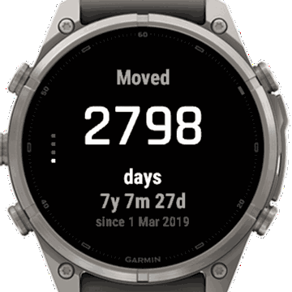
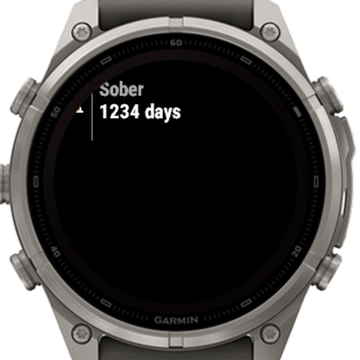
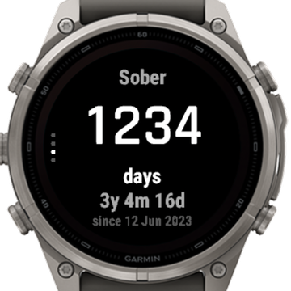
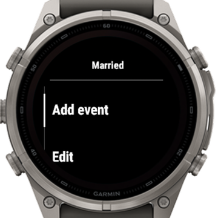
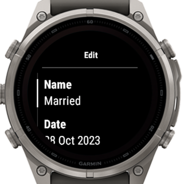

# Countup

A Garmin Connect IQ app that counts days **since** a date, the mirror of the built-in Countdown. Built for and tested only on the **fēnix 9 Pro Solar 47mm** (`fenix9prosolar47mm`).

- Up to 10 events (name + date in the past), sorted newest first
- Event screen: days passed, `3y 4m 17d`, start date; UP/DOWN to switch events
- Glance: name and day count of the chosen event
- Milestones (every 100 days and anniversaries) shown in gold on that day
- Add, edit and delete events on the watch; no phone settings, no permissions

<p align="center">
  
</p>

| Glance | Event | Menu | Edit |
|:---:|:---:|:---:|:---:|
|  |  |  |  |

Screenshots from the Connect IQ simulator with sample events.

Design and decisions (in Ukrainian): [PLAN.md](PLAN.md).

## Build

Requires the Connect IQ SDK with the `fenix9prosolar47mm` device, JDK 17, and a developer key at `developer_key` in the project root (not committed; generate your own with `openssl`, see the [Connect IQ getting started guide](https://developer.garmin.com/connect-iq/connect-iq-basics/getting-started/)).

The scripts wrap the [garmin-dev](https://github.com/athitupakan/garmin-dev-skills) Claude Code plugin's scripts:

```bash
scripts/build.sh         # debug build
scripts/run.sh           # start the simulator, build, run
scripts/test.sh          # unit tests in the simulator
scripts/release.sh       # bin/countup-garmin-app-release.prg
```

The README images come from a separate demo build (`screenshots.jungle`, fixed sample events) driven in the simulator by `python3 -I scripts/capture-readme.py` (macOS, needs Pillow plus Screen Recording and Accessibility permissions).

## Install

Download `countup.prg` from the [latest release](https://github.com/jarkinV/countup-garmin-app/releases/latest) (or build `bin/countup-garmin-app-release.prg` yourself) and copy it to `GARMIN/APPS` on the watch (on macOS via an MTP client such as OpenMTP), then add **Countup** to the glance list.

## License

[MIT](LICENSE)
